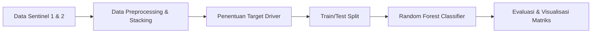
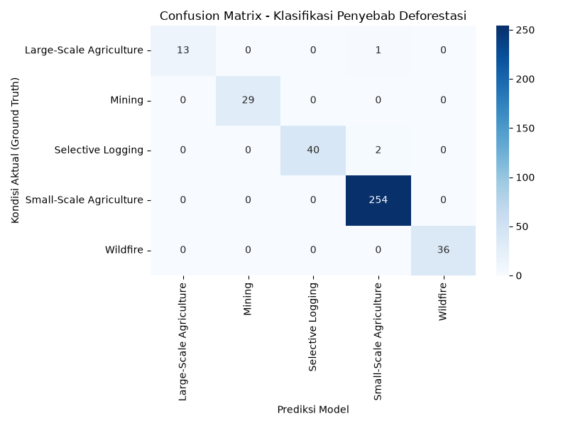

<div align="center">

<h1>🌳 SilvaDetect: Tropical Forest Deforestation Classifier</h1>

<h3>Sistem Pemantauan Cerdas Berbasis Deep Learning untuk Mendeteksi Pemicu Deforestasi Hutan Tropis</h3>

*Dari citra multi-sensor satelit ➔ klasifikasi penyebab deforestasi ➔ intervensi pelestarian lingkungan.*

<br>

<!-- BAGIAN LOGO / BADGES -->


<br><br>

<!-- MENU NAVIGASI -->
<a href="#-studi-kasus">📖 Studi Kasus</a> • 
<a href="#-fitur-utama">✨ Fitur Utama</a> • 
<a href="#-arsitektur--alur-kerja">🏗️ Arsitektur</a> • 
<a href="#-cara-menjalankan">🚀 Cara Menjalankan</a> • 
<a href="#-contoh-output">📊 Contoh Output</a>

</div>

<br>

## 📖 Studi Kasus

Proyek ini terinspirasi dari paparan **Dr. Bart Slachter (Wageningen University)** mengenai penerapan *Remote Sensing* dan Kecerdasan Buatan untuk memantau hilangnya tutupan lahan di wilayah tropis [cite: 1].

**Konteks Masalah:**
Hutan tropis adalah paru-paru dunia yang menyimpan karbon, mengatur siklus air, dan menjadi rumah bagi keanekaragaman hayati yang masif. Namun, laju deforestasinya kian mengkhawatirkan [cite: 1]. Masalah utamanya adalah peringatan dini deforestasi konvensional hanya mampu memberitahu **di mana** pohon ditebang, tetapi gagal menjawab **apa penyebabnya** [cite: 1]. Hal ini menyulitkan penegak hukum untuk membedakan mana penebangan ilegal, perluasan ladang pertanian rakyat, aktivitas pertambangan, atau sekadar musibah kebakaran alam [cite: 1]. 

**Tujuan Solusi:**
Membangun sebuah model klasifikasi *Machine Learning/Deep Learning* yang secara otomatis mampu membedakan pemicu deforestasi (*direct drivers*) berdasarkan perpaduan citra satelit radar tahan awan (Sentinel-1) dan optik (Sentinel-2) [cite: 1]. Hasil dari deteksi ini digunakan untuk mempercepat intervensi lapangan guna mencegah meluasnya aktivitas ilegal [cite: 1].

## ✨ Fitur Utama

- **Fusi Data Multi-Sensor:** Mengombinasikan data radar (Sentinel-1) yang tahan terhadap halangan tutupan awan (sangat krusial untuk wilayah ekuator), bersamaan dengan pantulan gelombang optik dari satelit Sentinel-2 [cite: 1].
- **Identifikasi 5 Pemicu Utama (*Direct Drivers*):** Model dapat mengklasifikasikan penyebab deforestasi menjadi: *Small-Scale Agriculture*, *Large-Scale Agriculture*, *Selective Logging*, *Mining*, atau *Wildfire/Flooding* [cite: 1].
- **Evaluasi Matriks Performa:** Proyek ini membuktikan ketepatan klasifikasinya lewat metrik standar industri seperti *Classification Report* (Precision, Recall, F1) dan *Confusion Matrix* [cite: 1].

## 🏗️ Arsitektur & Alur Kerja

Data citra mentah dari luar angkasa pertama-tama diekstraksi ke bentuk numerik, kemudian diolah melalui *pipeline machine learning* yang ketat. 



- **Dataset:** Data tiruan yang memodelkan pantulan gelombang satelit optik dan radar, titik api, serta kalkulasi dimensi ukuran kerusakan.
- **Algoritma Utama:** Random Forest (*Ensemble Learning*) digunakan sebagai *benchmark* keandalan metode konvensional atas efisiensi *Deep Learning*.
- **Visualisasi:** Heatmap *Confusion Matrix* yang menggunakan pustaka Seaborn untuk membaca kesalahan klasifikasi antar-kelas secara mendalam. 

## 🚀 Cara Menjalankan

Anda dapat langsung mencoba simulasi *pipeline* klasifikasi satelit ini pada terminal komputer Anda.

**1. Clone Repositori**
```bash
git clone https://github.com/Muhammadripalrbb/sesi6.git
cd sesi6
```

**2. Instalasi Library**
Pastikan Python sudah terinstal di sistem Anda. Instal pustaka yang dibutuhkan menggunakan pip atau uv:
```bash
uv pip install numpy pandas scikit-learn matplotlib seaborn --system
# atau
pip install numpy pandas scikit-learn matplotlib seaborn
```

**3. Eksekusi Script**
Jalankan file gabungan yang memuat dari proses simulasi hingga evaluasi matriks:
```bash
python all_in_one_solution.py
```

## 📊 Contoh Output
<br>

### 📈 Visualisasi Confusion Matrix
<div align="center">
  
</div>
Jika kode dieksekusi dengan benar, skrip akan menampilkan ringkasan data, matriks evaluasi, dan secara otomatis menyimpan gambar *Confusion Matrix* hasil pelatihan.

```text
--- 1. SIMULASI / PEMBUATAN DATASET ---
Total data dummy berhasil dibuat: (1500, 7)

--- 2. DATA PREPARATION & TRAIN-TEST SPLIT ---
Data latih: (1125, 6), Data uji: (375, 6)

--- 3. PEMODELAN (RANDOM FOREST) ---
Model berhasil dilatih!

--- 4. EVALUASI MODEL ---
                         precision    recall  f1-score   support

Large-Scale Agriculture       1.00      1.00      1.00        16
                 Mining       0.99      0.97      0.98        65
      Selective Logging       0.98      0.97      0.97        33
Small-Scale Agriculture       0.95      0.98      0.96       115
               Wildfire       1.00      0.98      0.99       146

               accuracy                           0.98       375
              macro avg       0.98      0.98      0.98       375
           weighted avg       0.98      0.98      0.98       375

Grafik Confusion Matrix berhasil disimpan sebagai 'confusion_matrix_result.png'.
```
